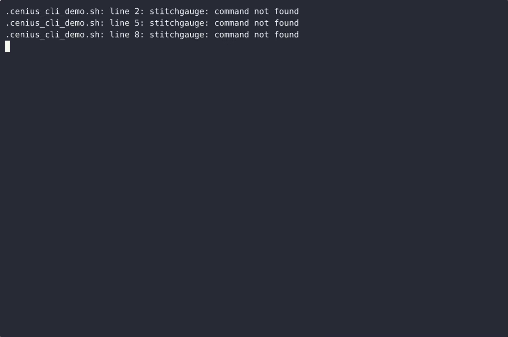

# StitchGauge — complete Full-stack app command-line tool example app

Need a self-hosted command-line tool? **StitchGauge** is the open-source answer: a Full-stack app project you can clone, run, and own. StitchGauge is a single-file, standard-library Python command-line tool with three plain-text calculators: a gauge swatch calculator that turns a knitted swatch's stitch/row counts and measurements into stitches-per-i…. Every StitchGauge line of code is here — no stripped demo, no paywalled features. Apache-2.0-licensed; [remix StitchGauge on cenius.ai](https://cenius.ai/marketplace/p/stitchgauge?ref=gh&utm_campaign=stitchgauge-webapp) for a bespoke custom version.


[](LICENSE)  [](https://cenius.ai)

[](https://cenius.ai/marketplace/p/stitchgauge?ref=gh&utm_campaign=stitchgauge-webapp)

> **▶ [Open & edit in cenius.ai](https://cenius.ai/marketplace/p/stitchgauge?ref=gh&utm_campaign=stitchgauge-webapp)** — one click to an editable workspace: describe changes in plain English, get an instant preview, one-click deploy and host. Modifications made on the platform come with full rebrand & relicense rights.

_Local clone? See [Quick start](#quick-start) below. cenius.ai is the zero-setup path._

## Demo


▶ **[Full demo walkthrough](https://cenius.ai/marketplace/p/stitchgauge?ref=gh&utm_campaign=stitchgauge-webapp)** — watch it on the project page · [download MP4](.github/media/demo.mp4)

## Screenshots



## Features

- Gauge swatch calculator
- Stitch-to-row ratio adjuster
- Yarn weight substitution helper

## Quick start

```bash
./install.sh   # installs dependencies + seeds demo data
```

See [`INSTALL.md`](INSTALL.md) for full setup and usage instructions.

## Usage guide

Two front ends, one set of calculations. The interactive menu and the one-shot
flags print byte-identical result blocks, so your terminal session and your
shell script never disagree.

### 1. Gauge calculator

**Question:** my swatch is *N* stitches x *M* rows over *W* x *H* inches - what
is my gauge?

Interactive: run `python3 stitchgauge.py`, then pick `1`.

```
Choose 1-6: 1
Stitch count of your swatch: 40
Row count of your swatch: 56
Swatch width in inches: 8
Swatch height in inches: 8

  GAUGE
  --------------------------------------------------------
  Stitch count          : 40
  Row count             : 56
  Swatch width (in)     : 8.00
  Swatch height (in)    : 8.00
  --------------------------------------------------------
  Stitches per inch     : 5.00
  Rows per inch         : 7.00
```

One-shot:

```bash
python3 stitchgauge.py gauge --stitches 40 --rows 56 --width 8 --height 8
```

`stitches per inch = stitches / width`, `rows per inch = rows / height`, both
printed to two decimals with all four inputs echoed so the block is
self-checking.

### 2. Adjust for your gauge

**Question:** the pattern is written at one gauge and I knit at another - how
many stitches and rows do I need?

Interactive: pick `2` and answer the six prompts in order (pattern stitch
gauge, pattern row gauge, your stitch gauge, your row gauge, pattern stitch
count, pattern row count).

One-shot:

```bash
python3 stitchgauge.py adjust --pattern-sts 5 --pattern-rows 7 \
                              --your-sts 5.5 --your-rows 7.5 \
                              --stitches 100 --rows 120
```

_Full guide: [`USAGE.md`](USAGE.md)_

## Architecture

Full-stack app project, delivered as a complete runnable codebase (24 files). Top-level layout: `demo/`, `tests/`. The setup script (`install.sh`) installs runtime dependencies and loads a starter dataset so the app is immediately usable. Installation walkthrough: [`INSTALL.md`](INSTALL.md).

## FAQ

### Can I deploy StitchGauge on my own infrastructure?

Grab the repo and run `./install.sh` — it handles packages and seed data in one go. After that, [`INSTALL.md`](INSTALL.md) walks you through starting the server. No external accounts required.

### Is StitchGauge editable without a developer?

[cenius.ai](https://cenius.ai/marketplace/p/stitchgauge?ref=gh&utm_campaign=stitchgauge-webapp) handles the implementation. Tell it what you want in everyday words, pick up the updated build. No coding needed.

### Can I rebrand or white-label StitchGauge?

Absolutely. [Open it on cenius.ai](https://cenius.ai/marketplace/p/stitchgauge?ref=gh&utm_campaign=stitchgauge-webapp) and remix it there — platform modifications come with full rebrand and relicense rights over your derivative, so the result is entirely yours.

### Which technology stack does StitchGauge use?

StitchGauge runs on Full-stack app. This repo holds the full production source: you can inspect every part of it before deploying. Highlights include stitch-to-row ratio adjuster.

### What license does StitchGauge use?

Yes — Apache-2.0-licensed, so commercial use, modification, and distribution are all permitted. Read the full terms in [LICENSE](LICENSE).

## License & rebranding

Released under the [Apache License 2.0](LICENSE) (© 2026 Cenius AI) — free for personal and commercial use. The Cenius name/logo are trademarks (see NOTICE).

**Need a customized version?** [Remix this app on cenius.ai](https://cenius.ai/marketplace/p/stitchgauge?ref=gh&utm_campaign=stitchgauge-webapp) — modifications made on the platform come with **full rebrand & relicense rights** over your derivative.

## Built with cenius.ai

This entire application — code, design, seeded demo data — was generated on **[cenius.ai](https://cenius.ai)** from a plain-English description.

- 🚀 [Build your own app on cenius.ai](https://cenius.ai)
- 🎛️ [Remix StitchGauge on the marketplace](https://cenius.ai/marketplace/p/stitchgauge?ref=gh&utm_campaign=stitchgauge-webapp) — open it in a workspace, prompt for changes, and ship your own version.

More open-source apps: [the Cenius-ai catalog](https://github.com/Cenius-ai) · [showcase index](https://github.com/Cenius-ai/showcase)
